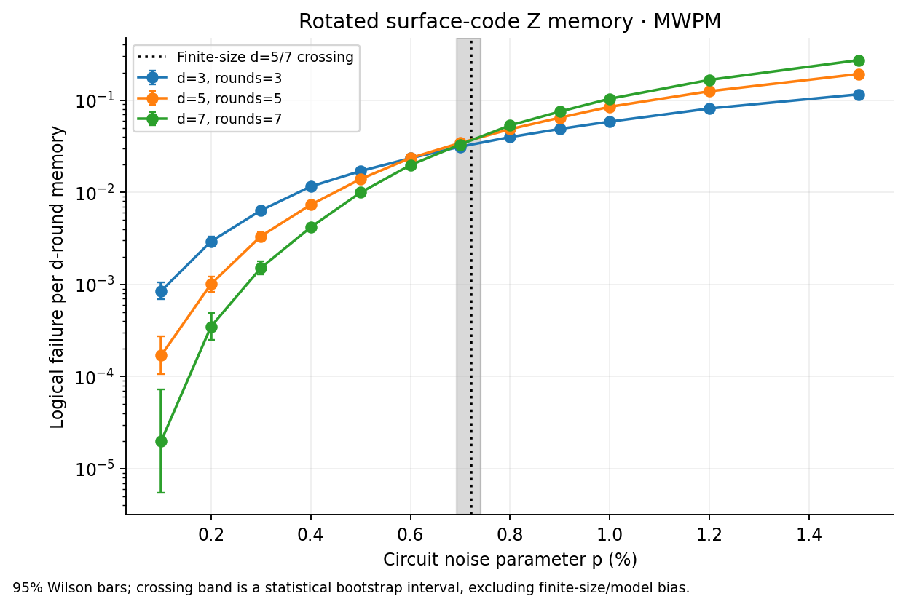
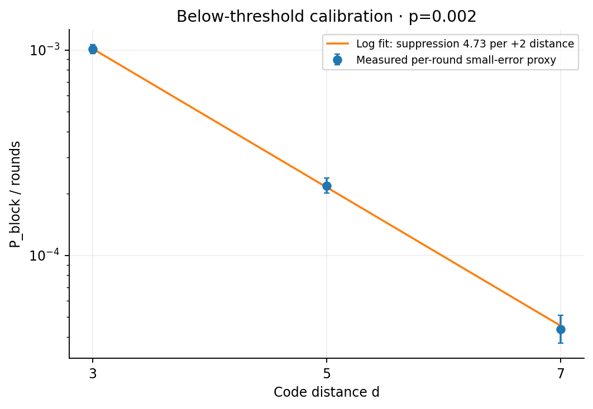
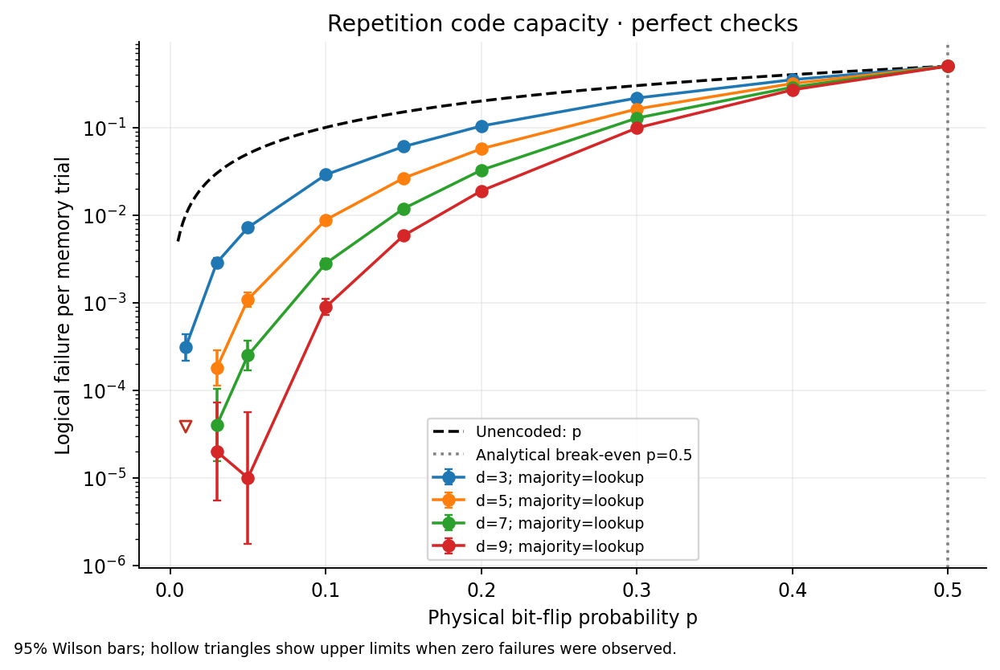
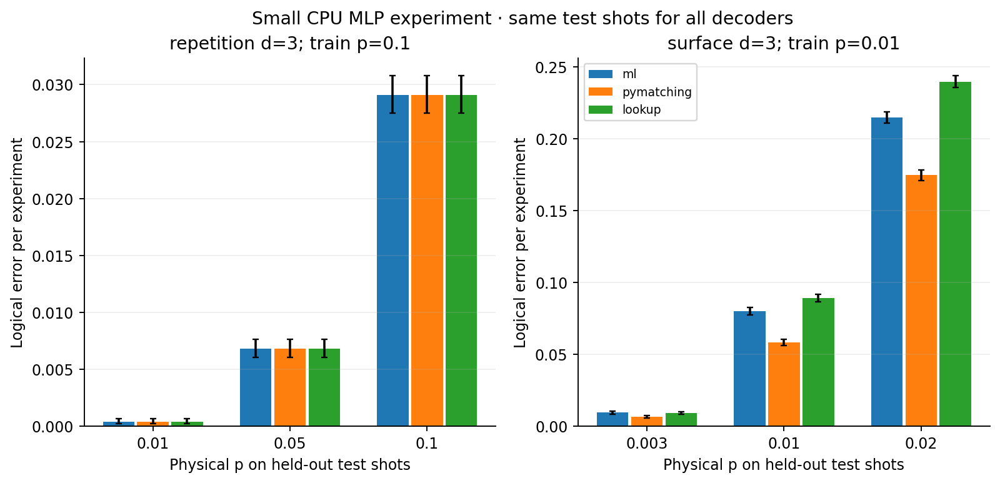

# qec-simulation-lab

A readable **Python 3.11, CPU-only** lab for implementing, simulating and decoding error-correcting memories. Start with [the concepts and worked examples](docs/concepts.md), written in the first commit, then follow the code and the [experiment plan fixed before the full run](docs/experiment-plan.md).

Own NumPy repetition codes, a noisy-measurement variant, Stim rotated-surface-code circuits decoded with PyMatching, confidence intervals, simplified resource extrapolation, and two small PyTorch MLP experiments. **No Docker, quantum hardware, quantum cloud account, provider API, or GPU is required.**

## Measured results

Full experiments ran on CPU on **3 November 2026 (Europe/Berlin)**; UTC timestamps, exact package versions and elapsed time are in [environment.json](results/environment.json). **71 pytest tests passed locally**, with 0 failures/errors/skips. CI setup and verification are pending.

| Surface distance pair | Finite-size crossing estimate | Conditional 95% bootstrap CI |
|---|---:|---:|
| 3 vs 5 | 0.5981% | 0.5659–0.6337% |
| **5 vs 7 (predeclared primary)** | **0.7218%** | **0.6921–0.7413%** |
| 3 vs 7 | 0.6676% | 0.6505–0.6936% |

Each distance/noise point uses **100,000 shots**, with **1,000 binomial bootstrap resamples** for crossings. All bootstrap resamples found a crossing in the fixed p=0.001–0.015 grid. These are crossings of **whole d-round memory failure rates**, not asymptotic threshold measurements. The spread between distance pairs is larger than individual sampling intervals; a single primary interval does not capture finite-size/model uncertainty.

The estimates lie in the commonly quoted roughly **0.5–1% circuit-noise range**, but agreement is contextual. [Stephens (2014)](https://arxiv.org/abs/1311.5003) reports 0.502–1.140% for particular circuits/noise/decoding choices. Our four Stim noise channels, one memory basis, small distances and interpolated crossings are not identical to those protocols. **The sweep was not moved to obtain a nicer crossing.**



At fixed **p_ref=0.002**, a separate **500,000 shots per distance** calibration gave:

| d | Failures / shots | Failure per full memory experiment |
|---|---:|---:|
| 3 | 1,517 / 500,000 | 0.003034 |
| 5 | 547 / 500,000 | 0.001094 |
| 7 | 153 / 500,000 | 0.000306 |

Fitting `log(P_block/d) = log(A) - ((d+1)/2) log(Lambda_ref)` gives **Lambda_ref=4.7278× suppression per +2 distance**, with **95% bootstrap CI [4.4299, 5.0525]** and A=0.0226934. This is a per-round small-error proxy, constrained by only three distances. Half-count stabilization is used only for log fitting, not to alter raw rates. The fitted scale `p_ref*Lambda_ref ≈ 0.009456` is **not** the measured crossing threshold.



## NumPy repetition and noisy checks

At physical bit-flip p=0.1, **100,000 shots per distance**:

| Distance | Majority logical failures | Lookup failures | Measured logical error |
|---|---:|---:|---:|
| 3 | 2,883 | 2,883 | 0.02883 |
| 5 | 880 | 880 | 0.00880 |
| 7 | 280 | 280 | 0.00280 |
| 9 | 89 | 89 | 0.00089 |

Compare with unencoded error p=0.1. Majority and lookup agree on all sampled shots and exhaustive test patterns. For this ideal X-only code-capacity model the analytical nontrivial break-even is **p=0.5**; it is marked on the plot and is separate from a circuit-level quantum threshold. The repetition code does not protect the phase-error channel. Independent finite-shot points can fluctuate non-monotonically at rare-error rates; zero failures are plotted as confidence upper limits, not zero risk.



The NumPy phenomenological experiment adds data flips each round and measurement flips on the checks, followed by perfect final data readout. It compares full-history Viterbi path decoding, trusting only the last noisy check, and final-readout majority. Distances 3/5, rounds 3/5, q=0/0.02/0.05, data p=0.02, **3,000 shots per setting**. See [the complete table](results/report.md) and [plot](results/plots/phenomenological.png). The Viterbi implementation is exponential and educational; it is not a scalable decoder or the exact logical-class posterior.

## Simplified resource estimates

Target means **logical failure per d-round memory block**, not an application lifetime. Assume `Lambda(p)=Lambda_ref*p_ref/p` and `P_block≈d*A/Lambda(p)^((d+1)/2)`, then choose the smallest odd d≥3. A rotated patch uses `d²` data and `d²−1` check qubits, so physical memory qubits=`2d²−1` and rounds=d.

| Physical p | Target block error | Estimated distance | Physical qubits / logical memory | Rounds |
|---|---:|---:|---:|---:|
| 1e-3 | 1e-6 | 11 | 241 | 11 |
| 1e-3 | 1e-9 | 17 | 577 | 17 |
| 1e-4 | 1e-6 | 5 | 49 | 5 |
| 1e-4 | 1e-9 | 9 | 161 | 9 |

**All rows extrapolate in physical p**; three also exceed the fitted distance range. This extra p-power law is assumed, not fitted across noise levels. The target rates are far below directly observed rates. [Resource JSON](results/resources.json) retains count-bootstrap distance intervals, which do not include model bias. Narrow integer intervals do not establish hardware-design certainty. Routing, spare qubits, control electronics, logical gates and magic-state factories are excluded.

## Small AI-decoder comparison

Two MLPs, 32/16 hidden ReLU units, trained on **60,000 Stim shots**, with **12,000 independent validation shots**, 25 fixed epochs and CPU Adam. Validation alone selects the output threshold; all decoders use the **same 40,000 held-out test shots per point**. Repetition has 641 parameters and exact lookup; surface has 1,345 parameters and a training-only empirical lookup (ties/unseen=0). Matching uses the correct test-p noise model; the MLP and empirical table train at a single p, so off-training-p results include distribution shift.

| Code | Test p | MLP failures / 40,000 | PyMatching failures | Lookup failures | Observation |
|---|---:|---:|---:|---:|---|
| Repetition d=3 | 0.01 | 16 | 16 | 16 | Equal observed outcomes |
| Repetition d=3 | 0.05 | 272 | 272 | 272 | Equal observed outcomes |
| Repetition d=3 | 0.10 | 1,164 | 1,164 | 1,164 | Equal observed outcomes |
| Surface d=3 | 0.003 | 375 | 265 | 358 | Worse than MWPM; lookup difference inconclusive |
| Surface d=3 | 0.010 | 3,194 | 2,333 | 3,564 | Worse than MWPM, better than empirical lookup |
| Surface d=3 | 0.020 | 8,593 | 6,986 | 9,590 | Worse than MWPM, better than empirical lookup |

The surface MLP loses to MWPM at all three tested p values, with paired intervals supporting the differences. It beats empirical lookup at the two higher values; that baseline has many unseen syndromes. At p=0.003 the small MLP-versus-lookup difference is not resolved statistically. Repetition equality on these shots is not proof of equivalence or an advantage over a four-entry lookup table. [Full paired intervals and unseen fractions](results/ml_decoder.json) and [the report](results/report.md) are retained. One small architecture/training seed does not establish ML-decoder superiority.



## Run locally

Use a Python 3.11 environment; the CI compatibility matrix also covers 3.10 and 3.12. Install the **CPU wheel first**. `--no-deps` applies only to that first wheel download; the editable project installation then resolves its ordinary dependencies from PyPI.

```sh
python3.11 -m venv .venv
source .venv/bin/activate
python -m pip install --no-deps torch==2.10.0 --index-url https://download.pytorch.org/whl/cpu
python -m pip install -e '.[dev]'
python -m pytest
ruff check .
ruff format --check .
python -m qec run
```

Windows PowerShell: `py -3.11 -m venv .venv`, then `.\.venv\Scripts\Activate.ps1`; the remaining `python` commands are the same. In a restricted environment, pytest can use `--basetemp=artifacts/pytest-tmp`.

The full command regenerates `results/*.json`, two small CPU model checkpoints, **five PNG plots**, and [results/report.md](results/report.md). Existing results in the selected directory are overwritten. To preserve the committed measurement or do a quick smoke experiment:

```sh
python -m qec run --output artifacts/my-full-run
python -m qec run --quick --output artifacts/quick
```

The quick profile uses 1,000 shots per surface point, smaller calibration/training sets and 2 epochs. Its threshold/fit/resource/ML outputs are **smoke results only**. It uses the same grid and noise channels and never overwrites committed results in CI. Installation uses public package downloads; once installed, the experiments need no network or account.

## File-to-concept map

| File | Concepts and interview explanation |
|---|---|
| [docs/concepts.md](docs/concepts.md) | Physical/logical qubits, X/Z errors, worked syndromes, distance, fault tolerance, and why checks can fail; written first. |
| [docs/experiment-plan.md](docs/experiment-plan.md) | Fixed grids/seeds/budgets and precise definitions of each statistic before measuring it. |
| [src/qec/code_capacity.py](src/qec/code_capacity.py) | Own NumPy parity checks, majority/minimum-weight lookup, binomial tail and finite-state noisy-history decoding; no quantum-library imports. |
| [src/qec/surface_code.py](src/qec/surface_code.py) | Generated noisy memory circuits, detection events, MWPM observable prediction, Wilson statistics, finite-size crossings and suppression fit. |
| [src/qec/statistics.py](src/qec/statistics.py) | Failure counts, binomial proportions and 95% Wilson intervals, including zero counts. |
| [src/qec/resources.py](src/qec/resources.py) | Turn an explicitly assumed fitted law into odd distance, patch qubits and rounds; distinguish extrapolation from measurement. |
| [src/qec/ml_decoder.py](src/qec/ml_decoder.py) | Stim-labelled train/validation/test splits, logical-observable MLP, empirical lookup, paired comparisons, CPU checkpoint loading. |
| [src/qec/compile_notes.py](src/qec/compile_notes.py) | Optional hand-written Clifford/T counts and arbitrary fault-tolerance volume formulas; Stim is not used to simulate T gates. |
| [src/qec/experiments.py](src/qec/experiments.py) | Orchestrate fresh seeded experiments and write raw counts, metadata, models and estimates. |
| [src/qec/plots.py](src/qec/plots.py) | Plot actual rates/intervals, show zero-count upper limits, and use a correctly sampled unencoded reference on a log-y plot. |
| [src/qec/reporting.py](src/qec/reporting.py) | Build measured tables and explain finite-size, sampling, extrapolation and ML limitations. |
| [src/qec/__main__.py](src/qec/__main__.py) | `python -m qec run`, full/quick profiles, output directory and console summaries. |
| [tests/](tests/) | Exhaustive repetition correction patterns, initial surface faults, seeded statistical tolerances, resources, checkpoint I/O and rendered plot geometry. |

## Limitations

**Simulation only; standard independent noise; no quantum hardware; no cloud account; no real fault-tolerant compiler.** Only rotated surface-code **Z memory** is swept; this is not a universal logical-gate experiment or full algorithm. NumPy repetition protects bit flips only. Stim efficiently simulates Clifford/Pauli models, not arbitrary quantum circuits with coherent/non-Clifford noise. Leakage, crosstalk, correlated drift and a realistic idle schedule are absent.

Both one- and two-qubit depolarization have total event probability p (distributed among 3 or 15 nonidentity Pauli errors); reset/readout flips separately have probability p. Thus p is a shared **circuit-noise parameter**, not one universal physical-device error rate. MWPM assumes independent graphlike mechanisms after DEM decomposition and does not exploit all correlations.

Distances 3/5/7 do not determine an asymptotic threshold. Bootstrap/Wilson intervals quantify shot noise, not grid interpolation, finite-size or model bias. Raw rare-event counts can fluctuate; zero is not evidence of zero risk. Per-round division is a small-error approximation. The resource p-law and far-tail distances are simplified and unvalidated. The optional T-gate cost uses arbitrary factory numbers, not a distillation protocol or a compiler. The MLP is a small, single-seed experiment with no claim of practical advantage.

Fixed seeds are version/platform dependent (particularly Stim SIMD sampling and PyTorch arithmetic); matching seeds across machines does not guarantee identical bit streams. The full local environment is recorded; CI exercises a reduced profile and checks functionality rather than exact scientific snapshot equality.

## How this was built

Built with **OpenAI Codex**, the agentic coding tool used here. Concepts and the experiment plan were committed first, followed by readable implementation/test commits. Tests, visual inspection and error counts were reviewed before publishing. [Verification history](docs/verification.md) records setup/estimator/plot corrections and the final executed evidence. This is an educational project, not an independently reviewed QEC research result.
