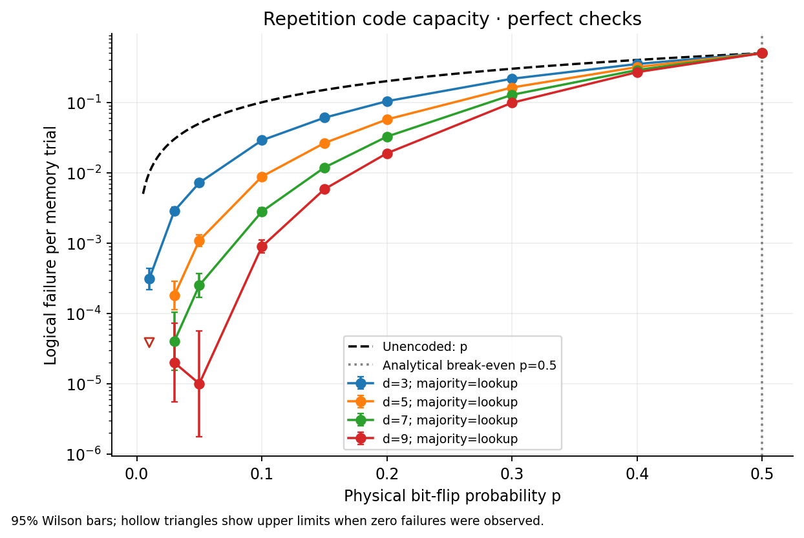
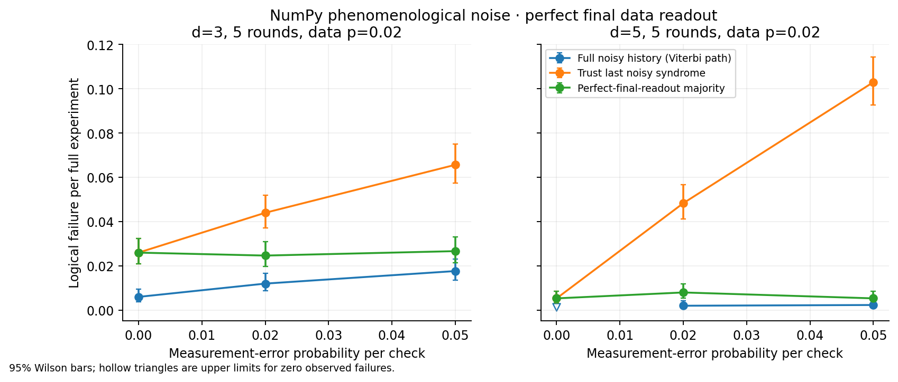
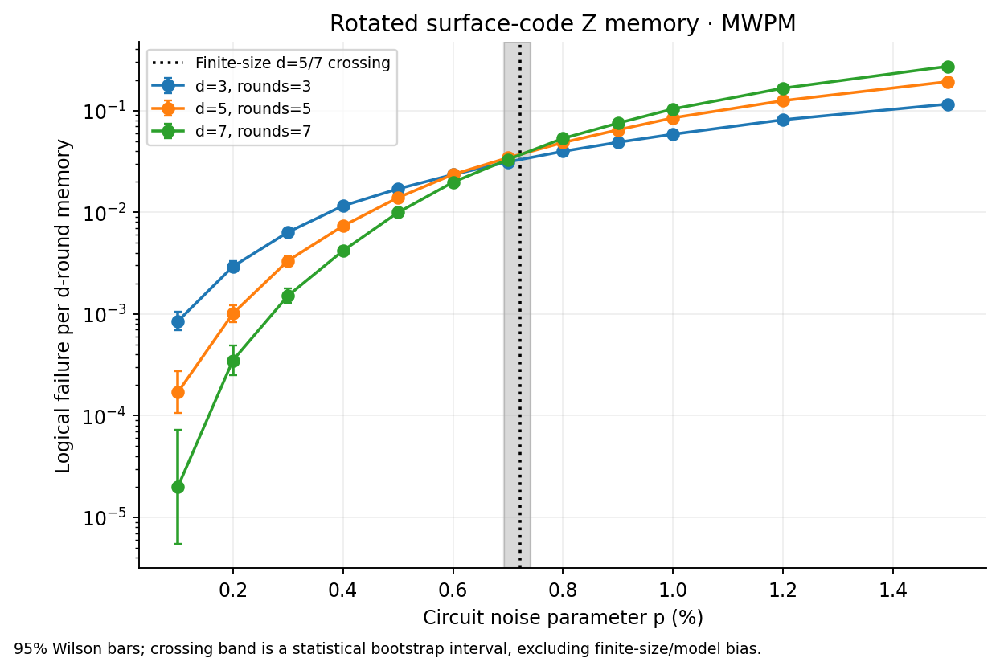
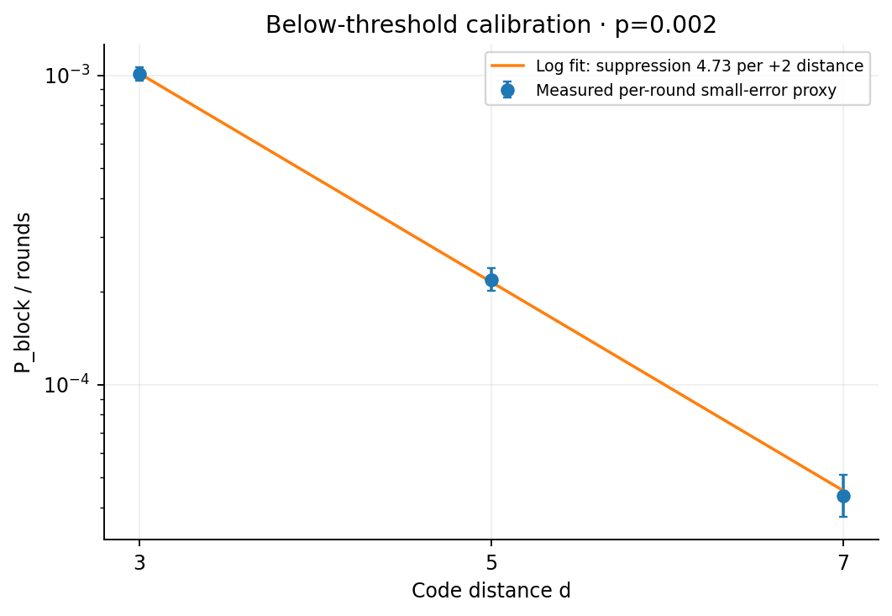
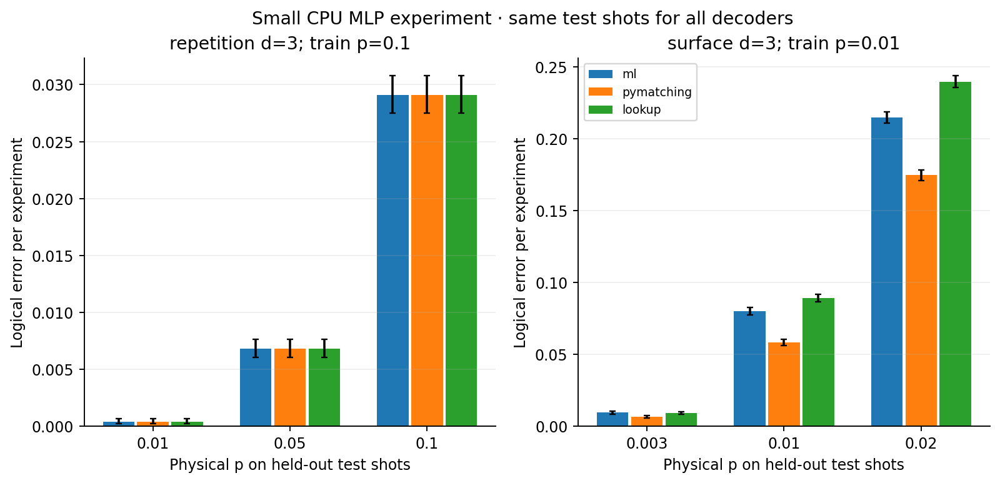

# QEC simulation lab: measured CPU results

Profile: **full**. UTC execution date: 2026-11-02T23:12:15.272277+00:00. Base seed: 20261102.

Simulation only. Independent Pauli/depolarizing noise; no hardware or cloud account. Rates below are per complete memory experiment unless explicitly marked otherwise. All proportion intervals are 95% Wilson intervals.

## Repetition code capacity

100,000 shots for each distance/noise point. Majority and syndrome lookup see identical shots. The nontrivial analytical break-even with unencoded p is **p=0.5** for this ideal X-only, perfect-check model; it is not a circuit threshold.

| d | p | Majority failures / shots | Logical error [95% CI] | Lookup failures | Unencoded failures | Exact binomial tail |
|---:|---:|---:|---|---:|---:|---:|
| 3 | 0.1 | 2883 / 100000 | 0.02883 [0.0278109, 0.0298853] | 2883 | 10112 | 0.028 |
| 3 | 0.5 | 50016 / 100000 | 0.50016 [0.497061, 0.503259] | 50016 | 49821 | 0.5 |
| 5 | 0.1 | 880 / 100000 | 0.0088 [0.00823972, 0.00939802] | 880 | 10021 | 0.00856 |
| 5 | 0.5 | 49943 / 100000 | 0.49943 [0.496331, 0.502529] | 49943 | 49862 | 0.5 |
| 7 | 0.1 | 280 / 100000 | 0.0028 [0.00249104, 0.00314715] | 280 | 10070 | 0.002728 |
| 7 | 0.5 | 50059 / 100000 | 0.50059 [0.497491, 0.503689] | 50059 | 50122 | 0.5 |
| 9 | 0.1 | 89 / 100000 | 0.00089 [0.000723364, 0.00109498] | 89 | 9923 | 0.00089092 |
| 9 | 0.5 | 50019 / 100000 | 0.50019 [0.497091, 0.503289] | 50019 | 50190 | 0.5 |

## Noisy measurements and multiple rounds

Data p=0.02 per round, perfect final data readout. Viterbi finds a most-likely history path, not the optimal logical-class posterior. Last-check decoding deliberately trusts a noisy final check; final-majority uses the perfect final readout but no history.

| d | Rounds | Measurement q | Viterbi failures / shots | Last-noisy-check failures | Final-majority failures |
|---:|---:|---:|---:|---:|---:|
| 3 | 3 | 0.0 | 21 / 3000 | 38 | 38 |
| 3 | 3 | 0.02 | 26 / 3000 | 69 | 25 |
| 3 | 3 | 0.05 | 24 / 3000 | 183 | 29 |
| 3 | 5 | 0.0 | 18 / 3000 | 78 | 78 |
| 3 | 5 | 0.02 | 36 / 3000 | 132 | 74 |
| 3 | 5 | 0.05 | 53 / 3000 | 197 | 80 |
| 5 | 3 | 0.0 | 0 / 3000 | 2 | 2 |
| 5 | 3 | 0.02 | 1 / 3000 | 100 | 2 |
| 5 | 3 | 0.05 | 1 / 3000 | 253 | 4 |
| 5 | 5 | 0.0 | 0 / 3000 | 16 | 16 |
| 5 | 5 | 0.02 | 6 / 3000 | 145 | 24 |
| 5 | 5 | 0.05 | 7 / 3000 | 309 | 16 |

## Circuit-level rotated surface code

Task: rotated_memory_z; distances 3,5,7; rounds=d; **100,000 shots per point**. All four Stim noise arguments equal p: after-Clifford depolarization, before-round data depolarization, measurement flips, reset flips. Only one logical Z-memory observable is tested. Default uncorrelated PyMatching MWPM uses a decomposed graphlike detector error model.

| d | Rounds | Active qubits | p | Failures / shots | Logical error [95% CI] |
|---:|---:|---:|---:|---:|---|
| 3 | 3 | 17 | 0.001 | 85 / 100000 | 0.00085 [0.00068754, 0.00105081] |
| 3 | 3 | 17 | 0.002 | 293 / 100000 | 0.00293 [0.00261356, 0.00328463] |
| 3 | 3 | 17 | 0.003 | 637 / 100000 | 0.00637 [0.00589551, 0.00688241] |
| 3 | 3 | 17 | 0.004 | 1156 / 100000 | 0.01156 [0.010916, 0.0122415] |
| 3 | 3 | 17 | 0.005 | 1699 / 100000 | 0.01699 [0.0162074, 0.0178097] |
| 3 | 3 | 17 | 0.006 | 2346 / 100000 | 0.02346 [0.02254, 0.0244166] |
| 3 | 3 | 17 | 0.007 | 3124 / 100000 | 0.03124 [0.0301796, 0.0323364] |
| 3 | 3 | 17 | 0.008 | 3972 / 100000 | 0.03972 [0.0385271, 0.0409483] |
| 3 | 3 | 17 | 0.009 | 4877 / 100000 | 0.04877 [0.0474523, 0.0501224] |
| 3 | 3 | 17 | 0.01 | 5852 / 100000 | 0.05852 [0.0570821, 0.0599918] |
| 3 | 3 | 17 | 0.012 | 8122 / 100000 | 0.08122 [0.0795429, 0.0829292] |
| 3 | 3 | 17 | 0.015 | 11586 / 100000 | 0.11586 [0.113891, 0.117858] |
| 5 | 5 | 49 | 0.001 | 17 / 100000 | 0.00017 [0.000106147, 0.000272253] |
| 5 | 5 | 49 | 0.002 | 101 / 100000 | 0.00101 [0.000831366, 0.00122697] |
| 5 | 5 | 49 | 0.003 | 334 / 100000 | 0.00334 [0.00300098, 0.00371718] |
| 5 | 5 | 49 | 0.004 | 733 / 100000 | 0.00733 [0.0068199, 0.00787795] |
| 5 | 5 | 49 | 0.005 | 1392 / 100000 | 0.01392 [0.0132123, 0.014665] |
| 5 | 5 | 49 | 0.006 | 2352 / 100000 | 0.02352 [0.0225989, 0.0244778] |
| 5 | 5 | 49 | 0.007 | 3435 / 100000 | 0.03435 [0.033239, 0.0354968] |
| 5 | 5 | 49 | 0.008 | 4847 / 100000 | 0.04847 [0.0471562, 0.0498185] |
| 5 | 5 | 49 | 0.009 | 6462 / 100000 | 0.06462 [0.0631129, 0.0661606] |
| 5 | 5 | 49 | 0.01 | 8478 / 100000 | 0.08478 [0.0830694, 0.0865225] |
| 5 | 5 | 49 | 0.012 | 12515 / 100000 | 0.12515 [0.123114, 0.127215] |
| 5 | 5 | 49 | 0.015 | 19261 / 100000 | 0.19261 [0.190178, 0.195066] |
| 7 | 7 | 97 | 0.001 | 2 / 100000 | 2e-05 [5.48474e-06, 7.29268e-05] |
| 7 | 7 | 97 | 0.002 | 35 / 100000 | 0.00035 [0.000251685, 0.000486702] |
| 7 | 7 | 97 | 0.003 | 151 / 100000 | 0.00151 [0.00128773, 0.00177057] |
| 7 | 7 | 97 | 0.004 | 418 / 100000 | 0.00418 [0.00379872, 0.00459937] |
| 7 | 7 | 97 | 0.005 | 995 / 100000 | 0.00995 [0.00935339, 0.0105843] |
| 7 | 7 | 97 | 0.006 | 1974 / 100000 | 0.01974 [0.0188961, 0.0206208] |
| 7 | 7 | 97 | 0.007 | 3302 / 100000 | 0.03302 [0.0319303, 0.0341456] |
| 7 | 7 | 97 | 0.008 | 5325 / 100000 | 0.05325 [0.0518754, 0.0546589] |
| 7 | 7 | 97 | 0.009 | 7526 / 100000 | 0.07526 [0.0736412, 0.0769114] |
| 7 | 7 | 97 | 0.01 | 10375 / 100000 | 0.10375 [0.101875, 0.105655] |
| 7 | 7 | 97 | 0.012 | 16606 / 100000 | 0.16606 [0.163766, 0.168379] |
| 7 | 7 | 97 | 0.015 | 27228 / 100000 | 0.27228 [0.26953, 0.275048] |

### Finite-size crossing estimates

The primary estimate is d=5 versus d=7. Linear interpolation in physical p; bootstrap intervals are conditional on finding a root. The first nontrivial root is used by the predeclared rule; all roots remain in JSON. These are finite-size crossings, not an asymptotic threshold determination.

| Pair | Crossing and conditional 95% bootstrap CI | Bootstrap with no crossing |
|---|---|---:|
| 3-5 | 0.5981% [0.5659%, 0.6337%] | 0.0% |
| 5-7 | 0.7218% [0.6921%, 0.7413%] | 0.0% |
| 3-7 | 0.6676% [0.6505%, 0.6936%] | 0.0% |

Distance-pair estimates range from **0.5981% to 0.7218%**. This pair dependence is a finite-size warning, not extra independent measurements of one universal threshold. A single pair's sampling interval does not capture this systematic spread.

The primary crossing is **inside** the commonly quoted roughly 0.5–1% circuit-noise context. [Stephens (2014)](https://arxiv.org/abs/1311.5003) reports 0.502–1.140% across specific assumptions; neither its circuit nor its noise convention is identical to this small experiment. No sweep was moved to force agreement. Statistical intervals omit finite-size, grid/interpolation, decoder-approximation and noise-model biases.

## Below-threshold distance scaling

Independent calibration at p_ref=0.002, **500,000 shots per distance**. Fit log(P_block/d) against (d+1)/2 at d=3,5,7. WLS weights sqrt(k+0.5), using (k+0.5)/(N+1) for log-fit stabilization only; raw rates are unchanged.

| d | Failures / shots | Whole-memory rate [95% CI] | P_block/d proxy |
|---:|---:|---|---:|
| 3 | 1517 / 500000 | 0.003034 [0.00288533, 0.00319031] | 0.00101133 |
| 5 | 547 / 500000 | 0.001094 [0.00100612, 0.00118954] | 0.0002188 |
| 7 | 153 / 500000 | 0.000306 [0.000261208, 0.00035847] | 4.37143e-05 |

**Suppression Lambda_ref=4.7278 per +2 distance; 95% bootstrap CI [4.4299, 5.0525].** A=0.0226934. Fitted noise scale p_ref×Lambda=0.00945566; this is a scaling parameter, **not another measured threshold**.

Calibration below the measured primary crossing: True. Zero-count distances: []. Only three distances constrain two fit parameters; interval reflects count noise, not extrapolation error.

## Simplified resource illustration

Assume Lambda(p)=Lambda_ref×p_ref/p and P_block≈d×A/Lambda(p)^((d+1)/2). Target is **failure per d-round memory block**, not an algorithm lifetime. Choose the smallest odd d>=3; qubits=2d²−1; rounds=d. The additional p-power law is assumed, not independently fitted. Counts omit routing, spares, magic-state factories, logical gates and control hardware.

| Physical p | Target per block | Needed d [bootstrap interval] | Physical qubits / logical memory | Rounds | Predicted block failure | Beyond fitted d? |
|---:|---:|---|---:|---:|---:|---|
| 0.001 | 1e-06 | 11 [11, 11] | 241 | 11 | 3.49253e-07 | True |
| 0.001 | 1e-09 | 17 [17, 17] | 577 | 17 | 6.38441e-10 | True |
| 0.0001 | 1e-06 | 5 [5, 5] | 49 | 5 | 1.34213e-07 | False |
| 0.0001 | 1e-09 | 9 [9, 9] | 161 | 9 | 2.70198e-11 | True |

Bootstrap distance intervals omit model bias and are conditional on solvable bootstrap fits; unresolved fractions are in resources.json. All four rows extrapolate in physical p, even when the chosen distance lies inside d=3,5,7. A narrow or single-integer bootstrap interval does not imply model certainty. These very small target rates are **extrapolated, not directly observed or validated**.

## Small PyTorch MLP decoder experiment

CPU only. A 32→16 hidden-unit ReLU MLP predicts the logical observable bit. Independent training/validation/test sampler seeds; validation alone chooses the output threshold. Matching knows each test p; MLP and surface lookup train at one fixed p. This difference and out-of-training-p distribution shifts matter. Surface lookup is empirical and defaults to 0 for unseen/tied syndromes; repetition lookup is exact minimum weight.

### repetition d=3

Train p=0.1; 60,000 training, 12,000 validation; 25 epochs; 641 parameters; threshold=0.50; training observable-flip fraction=0.0990. Checkpoint: `models/repetition_d3.pt`.

| Test p | MLP failures / shots [95% CI] | MWPM failures | Lookup failures | Unseen lookup syndromes | MLP vs MWPM | MLP vs lookup |
|---:|---|---:|---:|---:|---|---|
| 0.01 | 16 / 40000 [0.00024624, 0.00064971] | 16 | 16 | 0.00% | equal observed rate; delta=0 [0, 0]; inconclusive/equal, not an equivalence claim | equal observed rate; delta=0 [0, 0]; inconclusive/equal, not an equivalence claim |
| 0.05 | 272 / 40000 [0.0060406, 0.0076541] | 272 | 272 | 0.00% | equal observed rate; delta=0 [0, 0]; inconclusive/equal, not an equivalence claim | equal observed rate; delta=0 [0, 0]; inconclusive/equal, not an equivalence claim |
| 0.1 | 1164 / 40000 [0.027497, 0.030793] | 1164 | 1164 | 0.00% | equal observed rate; delta=0 [0, 0]; inconclusive/equal, not an equivalence claim | equal observed rate; delta=0 [0, 0]; inconclusive/equal, not an equivalence claim |
### surface d=3

Train p=0.01; 60,000 training, 12,000 validation; 25 epochs; 1345 parameters; threshold=0.45; training observable-flip fraction=0.1846. Checkpoint: `models/surface_d3.pt`.

| Test p | MLP failures / shots [95% CI] | MWPM failures | Lookup failures | Unseen lookup syndromes | MLP vs MWPM | MLP vs lookup |
|---:|---|---:|---:|---:|---|---|
| 0.003 | 375 / 40000 [0.0084766, 0.010368] | 265 | 358 | 1.33% | worse; delta=0.00275 [0.0019977, 0.0035023]; CI supports difference | worse; delta=0.000425 [-0.00045833, 0.0013083]; inconclusive/equal, not an equivalence claim |
| 0.01 | 3194 / 40000 [0.077234, 0.082547] | 2333 | 3564 | 17.16% | worse; delta=0.021525 [0.019309, 0.023741]; CI supports difference | better; delta=-0.00925 [-0.011868, -0.0066321]; CI supports difference |
| 0.02 | 8593 / 40000 [0.21083, 0.21888] | 6986 | 9590 | 50.51% | worse; delta=0.040175 [0.036409, 0.043941]; CI supports difference | better; delta=-0.024925 [-0.029211, -0.020639]; CI supports difference |

Paired intervals are approximate normal intervals for differences on common shots; sparse discordances are inconclusive. No hyperparameters were selected on test shots. One architecture/training seed is not a decoder research result or evidence of general ML superiority.

## Optional hand-written gate-count toy

| Circuit | Clifford gates | T gates | Toy sequential qubit-rounds |
|---|---:|---:|---:|
| Bell preparation (hand-written) | 2 | 0 | 102 |
| Single T sandwich (hand-written) | 2 | 1 | 1102 |
| Small phase sequence (hand-written) | 4 | 2 | 2204 |

Stim does not simulate T gates here. These are hand-written gate lists and arbitrary factory-cost formulas, **not a fault-tolerant compiler, protocol, or scheduling result**.

## Reproducibility and limits

See ../docs/experiment-plan.md for the preregistered grid, seeds, shot budgets and estimators, and ../docs/concepts.md for the worked examples. environment.json records library versions, CPU-only mode and elapsed time. Fixed seeds are version/platform dependent, especially Stim SIMD sampling. CI's quick sweep is a smoke check and does not reproduce the full statistical precision.

Simulation only; independent standard noise, one surface-memory basis, small distances, no quantum hardware, coherent/correlated errors, leakage, crosstalk or cloud service. Per-round division, p-scaling, required distances and toy factory costs are simplified. No claimed implementation of a general fault-tolerant quantum computer or compiler.
